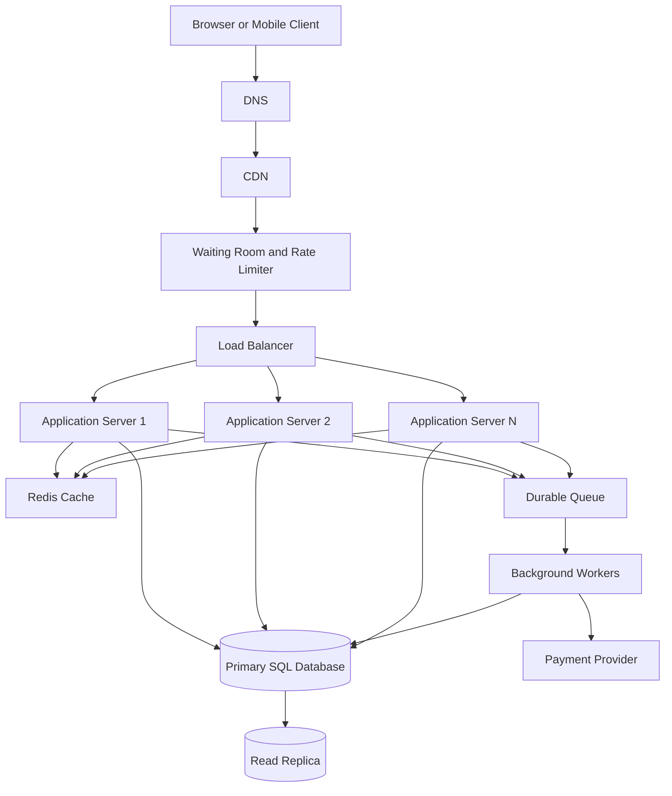

# TicketHub System Design

## 1. Requirements

### Functional requirements

1. Users can browse and search events by name, date, venue, and category.
2. Users can view event details and seat availability.
3. Authenticated users can temporarily hold available seats.
4. Users can pay for an order and receive purchase confirmation.
5. Users can view their orders and purchased tickets.
6. Seat holds expire after five minutes if payment is not completed.
7. The system prevents duplicate purchases and handles repeated payment requests safely.

### Non-functional requirements

- **Speed:** Event pages should normally load within 300 ms at the API layer. Seat-hold requests should normally complete within 500 ms, excluding network delays.
- **Correctness:** A seat must never be sold to two different customers. The database must be the authority for seat ownership.
- **Fairness:** During popular sales, users enter a server-managed waiting room. The system applies consistent queue rules and rate limits abusive requests.
- **Availability:** Multiple application servers should allow the service to continue if one server fails.
- **Security:** Authentication, authorization, input validation, and secure payment verification protect customer accounts and purchases.
- **Scalability:** The service must support two million registered users and sudden increases in traffic.
- **Reliability:** Failed jobs can be retried safely, and payment processing must avoid duplicate charges or orders.

## 2. Traffic estimates

These estimates are planning assumptions, not measured production data.

### Normal traffic

Registered users: 2,000,000.

Daily visitors: 50,000.

Each visitor views 10 pages.

Total daily page views:

50,000 × 10 = 500,000 page views/day.

Average page-view rate:

500,000 ÷ 86,400 ≈ 5.8 page views/second.

Assuming the busiest period reaches five times the average:

5.8 × 5 ≈ 29 page views/second.

Normal ticket sales: 5,000 per day.

Average sales rate:

5,000 ÷ 86,400 ≈ 0.058 ticket sales/second, or about 3.5 per minute.

### Popular concert sale

A popular concert has 20,000 seats, and 200,000 people try to buy tickets within ten minutes.

Average buyer arrival rate:

200,000 ÷ 600 ≈ 333 buyers/second.

Assuming each buyer makes three API requests during the sale:

200,000 × 3 ÷ 600 ≈ 1,000 API requests/second.

A short burst at twice that rate could reach approximately 2,000 API requests/second.

There are ten potential buyers per available seat. Even if every seat is sold, only 20,000 of the 200,000 interested buyers can obtain one.

### Comparison

The popular sale produces much higher traffic than a normal day. The service needs a CDN, caching for public information, a waiting room, horizontally scaled application servers, and a database designed to handle concurrent seat requests.

The waiting room controls incoming traffic, but the database must still enforce seat ownership. A cache must never be trusted to guarantee that a seat is available.

## 3. API design

The API returns JSON. Protected endpoints require authentication, and the server identifies the current user from the authenticated session or token.

| Method and path | Purpose | Success status |
|---|---|---|
| GET /api/events | Browse and search events | 200 OK |
| GET /api/events/{eventId} | View event details | 200 OK |
| GET /api/events/{eventId}/seats | View the seat map and availability | 200 OK |
| POST /api/events/{eventId}/holds | Temporarily reserve available seats | 201 Created |
| DELETE /api/holds/{holdId} | Release a seat hold | 204 No Content |
| POST /api/orders | Create an order from a valid hold | 201 Created |
| POST /api/orders/{orderId}/payment | Initiate payment | 202 Accepted |
| GET /api/me/orders | View the current user's orders | 200 OK |
| GET /api/me/tickets | View purchased tickets | 200 OK |

### Example: hold seats

Request:

POST /api/events/42/holds

```json
{
  "seatIds": [101, 102]
}
```

Response: `201 Created`

```json
{
  "holdId": 827,
  "seatIds": [101, 102],
  "status": "active",
  "expiresAt": "2026-11-02T18:05:00Z"
}
```

If another customer has already claimed a requested seat, the API returns `409 Conflict` instead of claiming the same seat.

### Example: create an order

Request:

POST /api/orders

```json
{
  "holdId": 827
}
```

Response: `201 Created`

```json
{
  "orderId": 501,
  "status": "pending_payment",
  "amount": 12000,
  "currency": "KES"
}
```

The amount is expressed in the smallest currency unit used by the payment integration. The backend calculates the amount from trusted seat prices rather than accepting a price from the client.

### Error status codes

- **400 Bad Request:** Invalid input.
- **401 Unauthorized:** Missing or invalid authentication.
- **403 Forbidden:** The user cannot access the resource.
- **404 Not Found:** The requested event, seat, hold, or order does not exist.
- **409 Conflict:** A seat is unavailable or a hold has expired.
- **429 Too Many Requests:** The request exceeds rate limits.
- **500 Internal Server Error:** An unexpected server-side failure occurred.

Example error response:

```json
{
  "error": {
    "code": "SEAT_UNAVAILABLE",
    "message": "One or more selected seats are no longer available."
  }
}
```

## 4. Data model

A relational SQL database is suitable because seat allocation and order processing require transactions, constraints, and reliable relationships.

### Entities and relationships

- **Users:** One user can place many orders.
- **Events:** One event has many seats.
- **Seats:** Each seat belongs to one event and has a unique seat number within that event.
- **Orders:** Each order belongs to one user and one event.
- **Seat holds:** Records which user temporarily holds a seat and when the hold expires.
- **Tickets:** Records confirmed ticket purchases. Each seat can have at most one confirmed ticket.

The relationships are one-to-many between users and orders, events and seats, and events and orders. Holds connect users to seats temporarily. Tickets associate sold seats with orders.

### Example SQL schema

The following uses PostgreSQL syntax.

```sql
CREATE TABLE users (
    id BIGINT GENERATED ALWAYS AS IDENTITY PRIMARY KEY,
    email VARCHAR(254) NOT NULL UNIQUE,
    display_name VARCHAR(100) NOT NULL,
    created_at TIMESTAMPTZ NOT NULL DEFAULT NOW()
);

CREATE TABLE events (
    id BIGINT GENERATED ALWAYS AS IDENTITY PRIMARY KEY,
    name VARCHAR(200) NOT NULL,
    venue VARCHAR(200) NOT NULL,
    starts_at TIMESTAMPTZ NOT NULL,
    status VARCHAR(20) NOT NULL
        CHECK (status IN ('draft', 'published', 'cancelled'))
);

CREATE TABLE seats (
    id BIGINT GENERATED ALWAYS AS IDENTITY PRIMARY KEY,
    event_id BIGINT NOT NULL REFERENCES events(id),
    seat_number VARCHAR(20) NOT NULL,
    price_kes BIGINT NOT NULL CHECK (price_kes >= 0),
    status VARCHAR(20) NOT NULL DEFAULT 'available'
        CHECK (status IN ('available', 'held', 'sold')),
    hold_expires_at TIMESTAMPTZ,
    UNIQUE (event_id, seat_number)
);

CREATE TABLE orders (
    id BIGINT GENERATED ALWAYS AS IDENTITY PRIMARY KEY,
    user_id BIGINT NOT NULL REFERENCES users(id),
    event_id BIGINT NOT NULL REFERENCES events(id),
    status VARCHAR(30) NOT NULL
        CHECK (status IN (
            'pending_payment', 'paid', 'expired',
            'cancelled', 'failed'
        )),
    total_kes BIGINT NOT NULL CHECK (total_kes >= 0),
    idempotency_key VARCHAR(100) NOT NULL UNIQUE,
    created_at TIMESTAMPTZ NOT NULL DEFAULT NOW()
);

CREATE TABLE seat_holds (
    id BIGINT GENERATED ALWAYS AS IDENTITY PRIMARY KEY,
    user_id BIGINT NOT NULL REFERENCES users(id),
    seat_id BIGINT NOT NULL REFERENCES seats(id),
    status VARCHAR(20) NOT NULL
        CHECK (status IN ('active', 'converted', 'released', 'expired')),
    expires_at TIMESTAMPTZ NOT NULL,
    created_at TIMESTAMPTZ NOT NULL DEFAULT NOW()
);

CREATE TABLE tickets (
    id BIGINT GENERATED ALWAYS AS IDENTITY PRIMARY KEY,
    order_id BIGINT NOT NULL REFERENCES orders(id),
    seat_id BIGINT NOT NULL UNIQUE REFERENCES seats(id),
    issued_at TIMESTAMPTZ NOT NULL DEFAULT NOW()
);
```

The unique constraint on `tickets.seat_id` prevents a seat from receiving two ticket records. A ticket is inserted only after a valid purchase is confirmed. In the same transaction, the seat is changed to `sold` and the order is marked `paid`.

### Example queries

Find upcoming published events:

```sql
SELECT id, name, venue, starts_at
FROM events
WHERE status = 'published'
  AND starts_at > NOW()
ORDER BY starts_at
LIMIT 20;
```

Find available seats for an event:

```sql
SELECT id, seat_number, price_kes
FROM seats
WHERE event_id = 42
  AND status = 'available'
ORDER BY seat_number;
```

View a user's purchased tickets using JOINs:

```sql
SELECT o.id AS order_id,
       e.name AS event_name,
       s.seat_number,
       t.issued_at
FROM orders o
JOIN events e ON e.id = o.event_id
JOIN tickets t ON t.order_id = o.id
JOIN seats s ON s.id = t.seat_id
WHERE o.user_id = 7
  AND o.status = 'paid'
ORDER BY t.issued_at DESC;
```

### Indexes

```sql
CREATE INDEX idx_events_status_starts_at
ON events (status, starts_at);

CREATE INDEX idx_seats_event_status
ON seats (event_id, status);

CREATE INDEX idx_orders_user_created
ON orders (user_id, created_at DESC);

CREATE INDEX idx_active_holds_expiry
ON seat_holds (expires_at)
WHERE status = 'active';
```

These indexes help event browsing, seat availability searches, order history, and hold expiry processing.

SQL is preferable to a document database as the primary store because TicketHub needs strong transactional guarantees and constraints across related records. A cache or search service may complement SQL, but the primary database remains authoritative for purchases.

## 5. Architecture



### Components and their purpose

- **Client:** Displays events and sends requests without deciding seat ownership.
- **DNS:** Directs clients to the service's public endpoint.
- **CDN:** Serves static assets and cacheable public content close to users.
- **Waiting room:** Controls admission during major sales and applies consistent queue rules.
- **Rate limiter:** Restricts excessive requests from individual clients.
- **Load balancer:** Distributes requests among healthy application servers.
- **Application servers:** Validate requests and execute application logic; multiple instances allow horizontal scaling.
- **Redis cache:** Speeds up frequently requested event information and availability snapshots.
- **Primary SQL database:** Stores authoritative seat, hold, order, and ticket information with transactional guarantees.
- **Read replica:** Handles suitable read-only queries to reduce primary database load.
- **Durable queue:** Buffers asynchronous tasks during traffic spikes.
- **Background workers:** Process queued notifications and other slow jobs with safe retries.
- **Payment provider:** Processes payments and sends confirmation callbacks that the backend verifies.

### GET /api/events/{eventId}/seats flow

1. The client requests the event's seat map.
2. DNS resolves the service, and the request passes through the waiting room, rate limiter, and load balancer.
3. An application server checks the cache for event information or a recent availability snapshot.
4. If necessary, the server retrieves display data from the database or read replica and refreshes the cache.
5. The API returns the seat map. The displayed availability is only a snapshot; the primary database must recheck the seat when a hold is requested.

### POST /api/events/{eventId}/holds flow

1. The authenticated client submits the requested seat IDs.
2. The request passes through the waiting room and load balancer to an application server.
3. The server validates the event, user, seats, and request limits.
4. A short database transaction locks the requested seat rows in a consistent order.
5. The server conditionally changes each seat from `available` to `held`, recording the hold expiry time.
6. The server verifies that every requested seat was acquired. If any seat is unavailable, the transaction rolls back so the user does not receive a partial hold.
7. The transaction commits, and the server returns the hold ID and expiry time.
8. The user completes payment while the hold is valid. After verified payment, another transaction inserts the ticket, marks the seat `sold`, and marks the order `paid`.
9. A background worker processes confirmation messages. Retries use idempotency keys to avoid duplicate orders or notifications.

### Preventing double-booking

Two users may see the same seat as available at nearly the same time. Therefore, checking availability in the browser or cache is not sufficient.

The primary database uses a transaction and row-level locks or atomic conditional updates. Only one request can successfully change a particular seat from `available` to `held`. The server checks the number of affected rows and rolls back the whole operation if all requested seats cannot be acquired.

A unique constraint on `(event_id, seat_number)` prevents duplicate seat definitions, while `UNIQUE (seat_id)` in the tickets table prevents the same seat from being issued twice.

After payment is verified, the backend marks the order paid, changes the seat to sold, and inserts the ticket in one transaction. Payment-provider calls happen outside database transactions to avoid holding locks during network delays. Idempotency keys and verified callbacks prevent duplicate processing.

If a hold expires, the system releases it safely. If payment succeeds after the hold has expired, the backend must reconcile the payment and either complete a still-valid purchase safely or refund it; it must never sell the seat twice.

## 6. Trade-offs and reliability

### Trade-off 1: Waiting room versus immediate access

A waiting room adds waiting time, but it reduces overload and applies consistent admission rules. During major sales, controlled access is preferable to allowing every request to hit the database at once. Queue position does not guarantee a ticket.

### Trade-off 2: Cache speed versus freshness

Caching reduces latency and database load, but seat availability may become stale. Cache public event details aggressively and use short expiry times for availability snapshots. Always validate seat ownership against the primary database before granting a hold.

### Trade-off 3: Strong correctness versus throughput

Database transactions and locks can limit throughput when many users compete for the same seats. Keep transactions short, acquire multiple seats in a consistent order, and reject conflicts quickly with `409 Conflict`. Correctness is more important than accepting every request.

### Avoiding single points of failure

Run multiple application servers across failure zones behind a health-checked load balancer. Use redundant DNS/CDN services, database backups and tested failover, and a durable queue. Workers must support safe retries, and payment processing must be idempotent.

The cache is an optimization rather than the source of truth, so a cache failure can trigger controlled database reads. If the primary database becomes unavailable, pause new holds and purchases rather than accepting bookings that cannot be confirmed safely.
